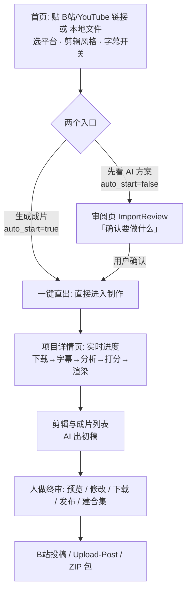
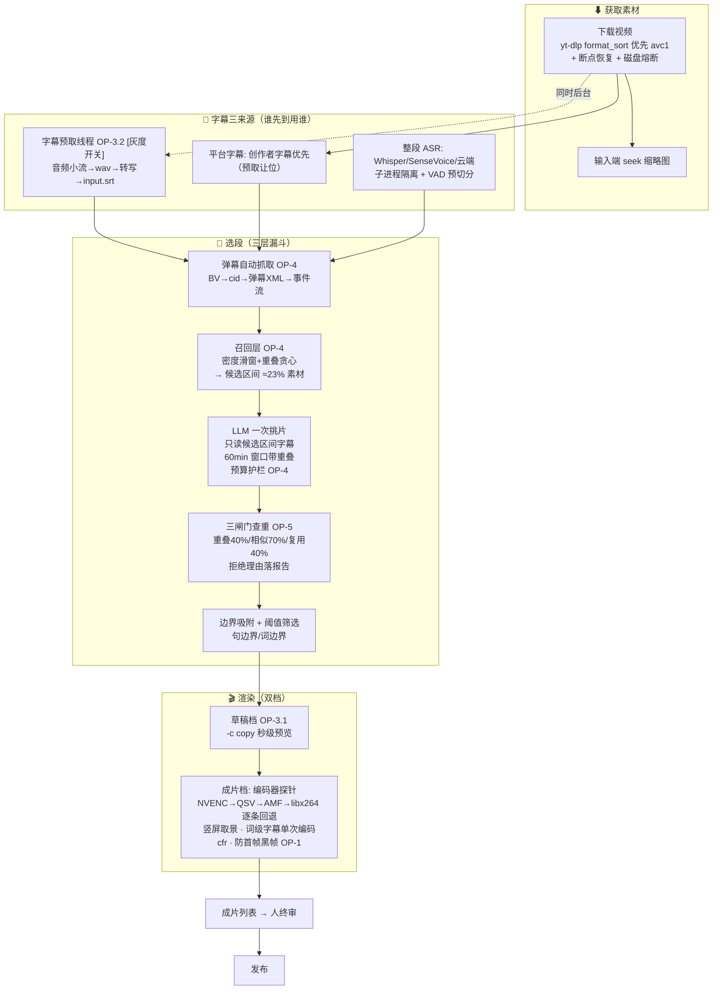

# 13 - 项目流程总览（优化后的完整链路）

- 日期：2026-11-14
- 用途：一张图看懂当前项目的**产品流程**与**引擎流水线**，标注每个环节对应的设计/优化出处
- 配套：《02-基底选型与能力吸收方案》《11-优化包实施方案》《12-优化包测试报告》《frontend/DESIGN.md》

---

## 1. 产品层流程（用户视角：两条路）

- **两条路的分工**：「生成成片」= 效率党一键到底；「先看 AI 方案」= 控制党先审后剪（2026-11-14 恢复，贯彻 02 文档「AI 出初稿、人做终审」理念）
- 终审界面就是详情页的「剪辑与成片」列表（每条：预览与修改 / 下载 / 发布 / 导出）——这就是你记忆里的"采纳/不采纳"，它一直是详情页形态

---

## 2. 引擎层流水线（制作阶段，标注优化出处）

---

## 3. 保障层（全程生效的横切机制）

| 机制 | 出处 | 作用 |
|---|---|---|
| 预算护栏 | OP-4 | LLM 调用前按 token 预算拦截（`max_llm_input_tokens`） |
| 磁盘熔断 | OP-6 | 下载/合集输出前检查剩余空间，不足即停 |
| 优雅退出 | OP-1 | ffmpeg 取消不产损坏文件（q/SIGINT→15s kill） |
| retryable 语义 | OP-2 | 计费错误不自动重试；网络错误才重试 |
| json_repair 兜底 | OP-2 | LLM 输出畸形时逐层修复，坏条目跳过不毁整单 |
| 缓存协议 | 既有 R3 | 每阶段产物落盘，重试/调参从断点续跑 |
| 审计回执 | OP-5 | 查重拒绝理由、召回开关状态落 quality_report.json |

---

## 4. 一分钟记忆版

> **两条路**：一键直出 / 先审后剪。
> **三来源**：平台字幕、字幕预取（后台）、整段转写——谁先到用谁。
> **三层漏斗**：弹幕召回 → LLM 精选（只读 23%）→ 三闸门查重。
> **双档渲染**：copy 草稿秒看 / 重编码成片。
> **终审在人**：详情页逐条采纳，发布才出网。

---

## 5. 灰度开关与环境速查

| 开关/依赖 | 默认 | 说明 |
|---|---|---|
| `AUTOCLIP_SEGMENTED_IMPORT` | 关 | 字幕预取（当前运行环境已开启=1） |
| `AUTOCLIP_DANMAKU_RECALL` | 开 | B站弹幕召回（设 0 关闭） |
| `AUTOCLIP_MAX_LLM_INPUT_TOKENS` | 不限 | 单任务 LLM 输入预算 |
| Redis 8.10.3 | — | `D:\Program Files (x86)\redis8\`（任务队列必需） |
| Celery worker | — | `--pool=solo`，5 队列（celery/processing/video/notification/upload） |
| 模型 API Key | 需用户填 | 设置页「服务商与模型」→ 测试连接 |

## 6. 待验证项（跑一次真实 B 站出片即可全部闭环）

1. 字幕预取状态流转（`raw/.subtitle_prefetch.json`：running→done→被 R3 消费）
2. 弹幕召回证据（quality_report.json `recalled: true`）
3. 快拼/黑帧修复的成片质量人工抽检
4. 三闸门拒绝理由在生产数据中的分布
